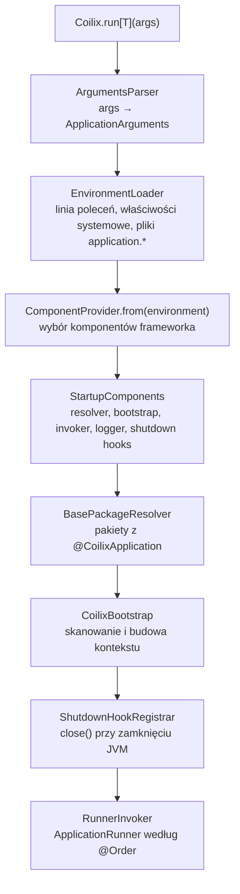
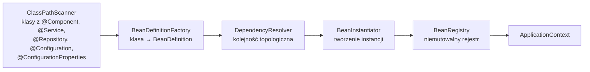

# Przegląd architektury

Jak Coilix startuje aplikację i buduje kontekst. Zasady podziału na moduły są w [modularity.md](modularity.md), wersjonowanie w [versioning.md](versioning.md), a decyzje, które ukształtowały ten projekt, w [docs/adr](../adr/README.md).

## Start aplikacji

`Coilix.run[App.type](args)` deleguje do `CoilixApplicationRunner.default`, czyli `DefaultCoilixApplicationRunner`:



1. **Argumenty.** `SimpleArgumentsParser` dzieli `args` na opcje (`--klucz=wartość` albo sama flaga `--klucz`) i argumenty pozycyjne.
2. **Konfiguracja.** `ClasspathEnvironmentLoader` składa warstwy od najważniejszej: opcje z linii poleceń, właściwości systemowe, `application.properties`, `application.yaml`/`.yml`, `application.conf`. Wynikiem jest `Environment`, który czyta wartości i wiąże je z typami (`ConfigBinder`).
3. **Komponenty frameworka.** `ComponentProvider` sprawdza, czy pod ścieżką komponentu (`coilix.context.*`, `coilix.boot.*`) jest klucz `class`. Jeśli tak, tworzy wskazaną klasę. Jeśli nie, używa domyślnej implementacji. Dzieje się to przed budową kontekstu, więc komponenty frameworka nie są beanami.
4. **Pakiety do skanowania.** `AnnotationBasePackageResolver` bierze `scanBasePackages` z `@CoilixApplication`, a gdy jest puste, pakiet klasy aplikacji.
5. **Kontekst.** `DefaultCoilixBootstrap` skanuje pakiety i przekazuje definicje do `ApplicationContextBuilder` (opis niżej).
6. **Po starcie.** Rejestrowany jest shutdown hook, który wywołuje `close()` kontekstu. Potem `OrderedRunnerInvoker` uruchamia beany `ApplicationRunner` w kolejności `@Order`.

## Budowa kontekstu



- **Skanowanie.** `ReflectionsClassPathScanner` (biblioteka `org.reflections`) szuka klas z adnotacjami komponentów w podanym pakiecie i sortuje je po nazwie, żeby wynik był powtarzalny.
- **Definicja beana.** `ReflectiveBeanDefinitionFactory` tworzy `BeanDefinition`: nazwę (`BeanNameGenerator`), klasę, `InstanceFactory` i listę zależności. Źródła definicji:
  - konstruktor wybrany przez `ConstructorSelector` (z `@Autowired`, a bez niego publiczny z największą liczbą parametrów), z parametrami zamienionymi na `Dependency` przez `ParameterDependencyMapper`,
  - metody `@Bean` w klasach `@Configuration` (`BeanMethodScanner`),
  - klasy `@ConfigurationProperties`, wiązane z configiem zamiast wywołania konstruktora z zależnościami.
- **Zależności.** `Dependency` ma cztery warianty: `Required` (zwykły typ), `Optional` (`Option[T]`), `Collection` (`List[T]`) i `Value` (`@Value`). Typy generyczne rozpoznaje `GenericDependencyTypeMapper`.
- **Kolejność.** `TopologicalDependencyResolver` ustawia definicje tak, żeby każdy bean powstawał po beanach, których wymaga. Brak kandydata to `NoSuchBeanException`, a cykl to `CircularDependencyException`. Na kolejność wpływają tylko zależności `Required`. Beany gotowe w tej samej rundzie powstają w kolejności skanowania (po nazwie klasy), więc `Option[T]` i `List[T]` widzą tylko beany utworzone wcześniej. To znane ograniczenie, opisane w ROADMAP.md.
- **Wybór kandydata.** `PrimaryCandidateSelector` wybiera najpierw bean dokładnie tej klasy, potem jedynego kandydata, a przy kilku kandydatach ten z `@Primary`. Bez jednego `@Primary` zgłasza `AmbiguousBeanException`.
- **Tworzenie.** `DefaultApplicationContextBuilder` składa rejestr przez `foldLeft` po uporządkowanych definicjach. Każdy krok dodaje nowy `RegisteredBean` do niemutowalnego `ImmutableBeanRegistry`.
- **Beany wbudowane.** Przed beanami aplikacji rejestr zawiera `applicationContext`, `applicationArguments` i `environment`, więc można je wstrzykiwać.

## Punkty rozszerzeń

Każdy komponent poniżej to trait z domyślną implementacją. Podmienia się go w configu kluczem `class` pod jego ścieżką, np.:

```yaml
coilix.context.bean-name-generator.class: com.example.PrefixedBeanNameGenerator
```

| Ścieżka | Trait | Domyślnie |
|---|---|---|
| `coilix.boot.bootstrap` | `CoilixBootstrap` | `DefaultCoilixBootstrap` |
| `coilix.boot.base-package-resolver` | `BasePackageResolver` | `AnnotationBasePackageResolver` |
| `coilix.boot.runner-invoker` | `RunnerInvoker` | `OrderedRunnerInvoker` |
| `coilix.boot.startup-logger` | `StartupLogger` | `Slf4jStartupLogger` |
| `coilix.boot.startup-message-formatter` | `StartupMessageFormatter` | `DefaultStartupMessageFormatter` |
| `coilix.boot.banner-loader` | `BannerLoader` | `ClasspathBannerLoader` |
| `coilix.boot.shutdown-hook-registrar` | `ShutdownHookRegistrar` | `RuntimeShutdownHookRegistrar` |
| `coilix.context.application-context-builder` | `ApplicationContextBuilder` | `DefaultApplicationContextBuilder` |
| `coilix.context.class-path-scanner` | `ClassPathScanner` | `ReflectionsClassPathScanner` |
| `coilix.context.bean-definition-factory` | `BeanDefinitionFactory` | `ReflectiveBeanDefinitionFactory` |
| `coilix.context.bean-method-scanner` | `BeanMethodScanner` | `ReflectiveBeanMethodScanner` |
| `coilix.context.bean-name-generator` | `BeanNameGenerator` | `SimpleBeanNameGenerator` |
| `coilix.context.constructor-selector` | `ConstructorSelector` | `AutowiredConstructorSelector` |
| `coilix.context.parameter-dependency-mapper` | `ParameterDependencyMapper` | `AnnotatedParameterDependencyMapper` |
| `coilix.context.dependency-type-mapper` | `DependencyTypeMapper` | `GenericDependencyTypeMapper` |
| `coilix.context.dependency-resolver` | `DependencyResolver` | `TopologicalDependencyResolver` |
| `coilix.context.candidate-selector` | `CandidateSelector` | `PrimaryCandidateSelector` |
| `coilix.context.bean-instantiator` | `BeanInstantiator` | `ReflectiveBeanInstantiator` |

Nowy komponent frameworka dopisuje się do tej tabeli w tym samym commicie, w którym dostaje `given ConfigPath`.

## Logowanie `@Slf4s`

`@Slf4s` to adnotacja Java z `02_annotations`. Plugin kompilatora `03_slf4s_plugin` dodaje do oznaczonej klasy lub obiektu pole `log: org.slf4j.Logger` w trakcie kompilacji, więc w runtime nie ma refleksji ani proxy. IntelliJ nie widzi zmian robionych przez plugin kompilatora, dlatego `11_intellij_plugin` dodaje to samo pole jako syntetyczny element w edytorze.

## Czego jeszcze nie ma

Cykl życia beanów (COILIX-00004), wątki (COILIX-00005), moduły opcjonalne przez SPI (COILIX-00010), zasięgi, profile, zdarzenia i wsparcie testów. Plan jest w [ROADMAP.md](../../ROADMAP.md) i w [tasks/](../../tasks/README.md).
