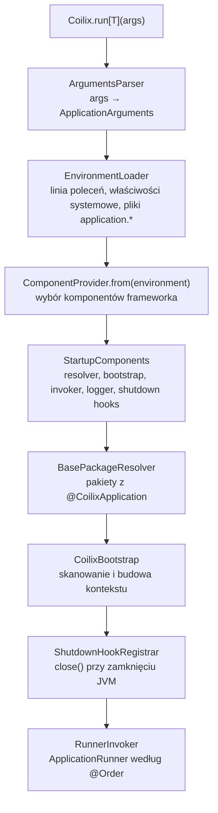
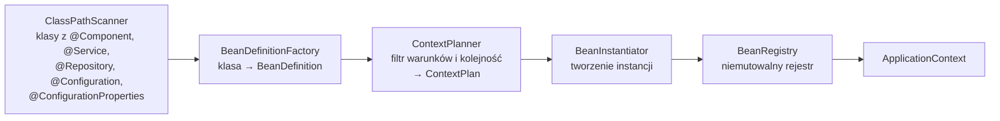

# Przegląd architektury

Jak Coilix startuje aplikację i buduje kontekst. Zasady podziału na moduły są w [modularity.md](modularity.md), wersjonowanie w [versioning.md](versioning.md), a decyzje, które ukształtowały ten projekt, w [docs/adr](../adr/README.md).

## Start aplikacji

`Coilix.run[App.type](args)` deleguje do `CoilixApplicationRunner.default`, czyli `DefaultCoilixApplicationRunner`:



1. **Argumenty.** `SimpleArgumentsParser` dzieli `args` na opcje (`--klucz=wartość` albo sama flaga `--klucz`) i argumenty pozycyjne.
2. **Konfiguracja.** `ClasspathEnvironmentLoader` składa warstwy od najważniejszej: opcje z linii poleceń, właściwości systemowe, `application.properties`, `application.yaml`/`.yml`, `application.conf`. Wynikiem jest `Environment`, który czyta wartości i wiąże je z typami (`ConfigBinder`).
3. **Komponenty frameworka.** `ComponentProvider` sprawdza, czy pod ścieżką komponentu (`coilix.context.*`, `coilix.boot.*`) jest klucz `class`. Jeśli tak, tworzy wskazaną klasę. Jeśli nie, używa domyślnej implementacji. Dzieje się to przed budową kontekstu, więc komponenty frameworka nie są beanami.
4. **Pakiety do skanowania.** `AnnotationBasePackageResolver` bierze `scanBasePackages` z `@CoilixApplication`, a gdy jest puste, pakiet klasy aplikacji.
5. **Kontekst.** `DefaultCoilixBootstrap` skanuje pakiety, dokłada komponenty modułów z classpath (`ModuleLoader`, zob. [modularity.md](modularity.md)), przepuszcza definicje przez `DefinitionProcessor`y modułów (`CoilixModule.definitionProcessors`, np. proxy `@Async`) i przekazuje je do `ApplicationContextBuilder` (opis niżej).
6. **Po starcie.** Rejestrowany jest shutdown hook, który wywołuje `close()` kontekstu. Potem `OrderedRunnerInvoker` uruchamia beany `ApplicationRunner` w kolejności `@Order`, między zdarzeniami `ContextReady` i `ApplicationStarted`. Gdy runner albo odbiorca tych zdarzeń rzuci wyjątek, publikowane jest `ApplicationFailed`, kontekst jest zamykany, a wyjątek idzie dalej.

## Budowa kontekstu



- **Skanowanie.** `ReflectionsClassPathScanner` (biblioteka `org.reflections`) szuka klas z adnotacjami komponentów w podanym pakiecie i sortuje je po nazwie, żeby wynik był powtarzalny.
- **Definicja beana.** `ReflectiveBeanDefinitionFactory` tworzy `BeanDefinition`: nazwę (`BeanNameGenerator`), klasę, `InstanceFactory` i listę zależności. Źródła definicji:
  - konstruktor wybrany przez `ConstructorSelector` (z `@Autowired`, a bez niego publiczny z największą liczbą parametrów), z parametrami zamienionymi na `Dependency` przez `ParameterDependencyMapper`,
  - metody `@Bean` w klasach `@Configuration` (`BeanMethodScanner`). Typ wyniku rozpoznany przez `EffectfulResultRecognizer` jako efekt (domyślnie po nazwie klasy `cats.effect.IO[A]` i `cats.effect.kernel.Resource[F, A]`) daje bean typu `A` z `BeanResult.Deferred` albo `BeanResult.Managed`, więc zależni dostają `A`, a nie efekt,
  - klasy `@ConfigurationProperties`, wiązane z configiem zamiast wywołania konstruktora z zależnościami.

  Każda definicja dostaje też metody cyklu życia klasy beana (`LifecycleMethods`) od `LifecycleMethodScanner`: `@PostConstruct` i `@PreDestroy`, także prywatne i z nadklas, po nazwie. Zła sygnatura (parametry, wynik inny niż `Unit`, metoda statyczna) daje `InvalidLifecycleMethodException` już na tym etapie.
- **Zależności.** `Dependency` ma pięć wariantów: `Required` (zwykły typ), `Named` (zwykły typ z `@Qualifier`, czyli bean o podanej nazwie), `Optional` (`Option[T]`), `Collection` (`List[T]`) i `Value` (`@Value`). Typy generyczne rozpoznaje `GenericDependencyTypeMapper`. Typ beana i zależności to `GenericType` z argumentami typów, więc `Repository[IO]` i `Repository[Option]` są różnymi typami. Zmienna typu bez wiązania i argument wyglądający na lambdę typu dają `UnsupportedDependencyTypeException` (ADR 0019).
- **Plan.** `DefaultContextPlanner` odrzuca definicje z niespełnionymi warunkami (`DefinitionFilter`), ustawia resztę w kolejności zależności (`DependencyResolver`) i zwraca `ContextPlan`: najpierw kroki `PlanStep.Provide` z gotowymi instancjami (kontekst i singletony), potem `PlanStep.Create` dla każdej definicji. Plan jest wartością, więc inny interpreter, np. w `IO` z modułu `cats-effect`, wykona te same kroki (ADR 0019).
- **Kolejność.** `TopologicalDependencyResolver` ustawia definicje tak, żeby każdy bean powstawał po beanach, których wymaga. Brak kandydata to `NoSuchBeanException`, a cykl to `CircularDependencyException`. Na kolejność wpływają tylko zależności `Required`. Beany gotowe w tej samej rundzie powstają w kolejności skanowania (po nazwie klasy), więc `Option[T]` i `List[T]` widzą tylko beany utworzone wcześniej. To znane ograniczenie, opisane w ROADMAP.md.
- **Wybór kandydata.** `PrimaryCandidateSelector` bierze beany, których typ pasuje do żądanego (`GenericType.isAssignableFrom`), i wybiera najpierw bean dokładnie tego typu, potem jedynego kandydata, a przy kilku kandydatach ten z `@Primary`. Bez jednego `@Primary` zgłasza `AmbiguousBeanException`.
- **Tworzenie.** `DefaultApplicationContextBuilder` wykonuje plan synchronicznie: składa rejestr przez `foldLeft` po krokach, a każdy krok dodaje nowy `RegisteredBean` do niemutowalnego `ImmutableBeanRegistry`. Plan z beanami tworzonymi przez efekt odrzuca przed utworzeniem pierwszego beana wyjątkiem `EffectfulBeanException` z podpowiedzią o module efektów.
- **Inicjalizacja.** `ReflectiveBeanInstantiator` przepuszcza nową instancję przez `BeanPostProcessor` przed rejestracją. Domyślny `PostConstructProcessor` wywołuje metody `@PostConstruct`, więc beany zależne dostają już zainicjalizowany obiekt. Wyjątek z takiej metody to `BeanCreationException` z nazwą beana i metody.
- **Zamykanie.** `close()` kontekstu przekazuje beany do `BeanDestroyer`. Domyślny `PreDestroyInvoker` wywołuje metody `@PreDestroy` od beana utworzonego jako ostatni. Wyjątek jest logowany jako `WARN` i nie przerywa niszczenia pozostałych beanów.
- **Słuchacze kontekstu.** Beany `ContextLifecycleListener` dostają `onContextStarted` od `DefaultApplicationContextBuilder`, gdy istnieją już wszystkie beany (wyjątek zamyka kontekst i przerywa start), i `onContextClosing` od `DefaultApplicationContext.close()` przed `BeanDestroyer`, faza po fazie według `ClosingPhase` (`Announcement`, `Producers`, `Events`, `Resources`, domyślnie `Producers`), a w obrębie fazy w odwrotnej kolejności tworzenia (wyjątek jest logowany, ADR 0024).
- **Komponenty zbierane przez moduły.** Moduł może w `CoilixModule.collects` podać adnotacje, których klasy nie mają być beanami (np. procesory tła z COILIX-00026). `DefaultCoilixBootstrap` szuka ich przez `ClassPathScanner.scanAnnotated` w skanowanych pakietach i wśród komponentów modułów, a `ComponentCollector` robi z nich jeden bean `collectedComponents` (`CollectedComponents`). Jego definicja zależy od wszystkich zależności zebranych klas, więc brakujący bean albo cykl wychodzi przy starcie. Moduł tworzy instancje przez `CollectedComponents.create` (zależności, `@Value`, `@PostConstruct`) i zamyka je przez `ManagedComponent.close` (`@PreDestroy`). Klasa z adnotacją komponentu i adnotacją zbieraną to `CollectedComponentConflictException`, a bean, który chce wstrzyknąć zebraną klasę, dostaje `NoSuchBeanException` z wyjaśnieniem (ADR 0017).
- **Beany wbudowane.** Przed beanami aplikacji rejestr zawiera `applicationContext`, `applicationArguments` i `environment`, więc można je wstrzykiwać.
- **Wątki.** Moduł rdzenia `concurrency` (`ConcurrencyModule`, ADR 0020) dodaje beany `concurrencySettings` (z `coilix.concurrency`), `taskExecutor` (`ExecutorServiceTaskExecutor`, pula obliczeniowa `ForkJoinPool` z wątkiem platformowym na rdzeń, ADR 0028), `blockingExecutor` (`ExecutorServiceBlockingExecutor`, wątek wirtualny na zadanie, na JDK 17 pula platformowa, opcjonalny limit `max-concurrency`) i `taskScheduler` (`ScheduledExecutorTaskScheduler`). Oba zamykają się przez `@PreDestroy` z limitem `shutdown-timeout`, po beanach, które z nich korzystają. Własny `TaskExecutor` albo `BlockingExecutor` (aplikacji albo modułu integracji) wyłącza domyślny przez `@ConditionalOnMissingBean`, więc jego pula nie powstaje. `scheduledMethodRegistrar` (`ContextLifecycleListener`) uruchamia metody `@Scheduled` po starcie kontekstu i anuluje je w fazie `Producers`. `RetryPolicy` to wspólny model ponowień (liczba prób, opóźnienie wykładnicze z rozrzutem) dla zdarzeń, procesorów i kodu aplikacji. `AsyncDefinitionProcessor` zamienia definicję beana z metodami `@Async` na proxy JDK traitu, który je deklaruje (ADR 0022). Metody cyklu życia proxy (`ProxiedBean`) wykonują się na obiekcie za proxy. Beany `ContextPropagator` (domyślnie `mdcContextPropagator`, ADR 0029) przenoszą kontekst wątku, np. MDC, do zadań obu wykonawców i harmonogramu przez `PropagatingExecutorService`. Błędy fatalne (`VirtualMachineError`, `LinkageError`) z zadań wykonawcy, harmonogramu i odbiorców asynchronicznych, a w `Coilix.run` z każdego wątku, trafiają do beana `fatalErrorHandler` (ADR 0027). Domyślny `ShutdownFatalErrorHandler` zamyka kontekst w nowym wątku i kończy proces przez bean `processTerminator` z kodem `coilix.fatal-errors.exit-code`, a strażnik woła `halt` po `shutdown-timeout`.
- **Zdarzenia.** Moduł rdzenia `events` (`EventsModule`, ADR 0025) dodaje beany `eventsSettings` (z `coilix.events`) i `eventBus` (`DefaultEventBus`, wstrzykiwany jako `EventPublisher` albo `EventBus`). Szyna jest `ContextLifecycleListener`: po starcie kontekstu szuka odbiorców (metody `@EventListener` i beany `ApplicationEventListener[E]`, także za proxy `ProxiedBean`) i dostarcza zdarzenia opublikowane przed startem, a w fazie `Events` odrzuca publikacje spoza odbiorców, anuluje czekające ponowienia i czeka na odbiorców asynchronicznych do `coilix.events.shutdown-timeout`. Odbiorcy synchroniczni działają w wątku publikującego, asynchroniczni na `TaskExecutor`, a ich ponowienia czekają na `TaskScheduler` według `RetryPolicy` z `coilix.events.listeners.<bean>.<metoda>.retry`. Zdarzenia są tylko w pamięci jednego procesu. Zdarzenia frameworka (ADR 0026): `StartupEvents.around` z `boot` publikuje `ContextReady` przed runnerami i `ApplicationStarted` po nich, a przy błędzie `ApplicationFailed`, po którym zamyka kontekst. Bean `contextClosingPublisher` publikuje `ContextClosing` w fazie `Announcement`. `coilix.events.synchronous = true` uruchamia odbiorców asynchronicznych w wątku publikującego (testkit: `withSynchronousEvents`).
- **Repliki.** Moduł rdzenia `cluster` (`ClusterModule`, ADR 0021), gdy jest na classpath, dodaje beany `clusterSettings` (z `coilix.cluster`) i `replicaIdentity`. `ReplicaIdentityResolver` ustala numer repliki i liczbę replik w trybie `single`, `static` albo `stateful-set`, a błąd daje `ReplicaIdentityException` przy starcie.

## Punkty rozszerzeń

Każdy komponent poniżej to trait z domyślną implementacją. Podmienia się go w configu kluczem `class` pod jego ścieżką, np.:

```yaml
coilix.context.bean-name-generator.class: com.example.PrefixedBeanNameGenerator
```

| Ścieżka | Trait | Domyślnie |
|---|---|---|
| `coilix.boot.bootstrap` | `CoilixBootstrap` | `DefaultCoilixBootstrap` |
| `coilix.boot.base-package-resolver` | `BasePackageResolver` | `AnnotationBasePackageResolver` |
| `coilix.boot.runner-invoker` | `RunnerInvoker` | `OrderedRunnerInvoker` |
| `coilix.boot.startup-logger` | `StartupLogger` | `Slf4jStartupLogger` |
| `coilix.boot.startup-message-formatter` | `StartupMessageFormatter` | `DefaultStartupMessageFormatter` |
| `coilix.boot.banner-loader` | `BannerLoader` | `ClasspathBannerLoader` |
| `coilix.boot.shutdown-hook-registrar` | `ShutdownHookRegistrar` | `RuntimeShutdownHookRegistrar` |
| `coilix.context.application-context-builder` | `ApplicationContextBuilder` | `DefaultApplicationContextBuilder` |
| `coilix.context.class-path-scanner` | `ClassPathScanner` | `ReflectionsClassPathScanner` |
| `coilix.context.module-loader` | `ModuleLoader` | `ServiceLoaderModuleLoader` |
| `coilix.context.component-collector` | `ComponentCollector` | `DefaultComponentCollector` |
| `coilix.context.bean-definition-factory` | `BeanDefinitionFactory` | `ReflectiveBeanDefinitionFactory` |
| `coilix.context.bean-method-scanner` | `BeanMethodScanner` | `ReflectiveBeanMethodScanner` |
| `coilix.context.bean-name-generator` | `BeanNameGenerator` | `SimpleBeanNameGenerator` |
| `coilix.context.constructor-selector` | `ConstructorSelector` | `AutowiredConstructorSelector` |
| `coilix.context.parameter-dependency-mapper` | `ParameterDependencyMapper` | `AnnotatedParameterDependencyMapper` |
| `coilix.context.dependency-type-mapper` | `DependencyTypeMapper` | `GenericDependencyTypeMapper` |
| `coilix.context.context-planner` | `ContextPlanner` | `DefaultContextPlanner` |
| `coilix.context.effectful-result-recognizer` | `EffectfulResultRecognizer` | `ClassNameEffectfulResultRecognizer.knownEffects` |
| `coilix.context.dependency-resolver` | `DependencyResolver` | `TopologicalDependencyResolver` |
| `coilix.context.candidate-selector` | `CandidateSelector` | `PrimaryCandidateSelector` |
| `coilix.context.bean-instantiator` | `BeanInstantiator` | `ReflectiveBeanInstantiator` |
| `coilix.context.lifecycle-method-scanner` | `LifecycleMethodScanner` | `AnnotatedLifecycleMethodScanner` |
| `coilix.context.bean-post-processor` | `BeanPostProcessor` | `PostConstructProcessor` |
| `coilix.context.bean-destroyer` | `BeanDestroyer` | `PreDestroyInvoker` |
| `coilix.context.condition-scanner` | `ConditionScanner` | `AnnotatedConditionScanner` |
| `coilix.context.definition-filter` | `DefinitionFilter` | `ConditionalDefinitionFilter` |

Nowy komponent frameworka dopisuje się do tej tabeli w tym samym commicie, w którym dostaje `given ConfigPath`.

## Logowanie `@Slf4s`

`@Slf4s` to adnotacja Java z `02_annotations`. Plugin kompilatora `03_slf4s_plugin` dodaje do oznaczonej klasy lub obiektu pole `log: org.slf4j.Logger` w trakcie kompilacji, więc w runtime nie ma refleksji ani proxy. IntelliJ nie widzi zmian robionych przez plugin kompilatora, dlatego plugin IntelliJ z repozytorium [Coilix/coilix-intellij](https://github.com/Coilix/coilix-intellij) dodaje to samo pole jako syntetyczny element w edytorze.

## Czego jeszcze nie ma

Przekazywanie MDC do zadań (COILIX-00005) i zasięgi beanów. Plan jest w [ROADMAP.md](../../ROADMAP.md) i w [tasks/](../../tasks/README.md).
